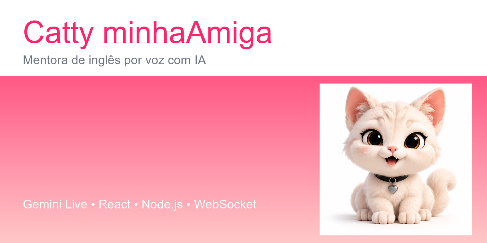

# Catty minhaAmiga

Uma mentora de inglês por voz com personalidade única. Converse com a Catty, uma gatinha sarcástica e divertida que te ensina inglês do zero ao avançado através de diálogos naturais, correções pontuais e explicações didáticas quando você precisar.



## ✨ Principais Funcionalidades

- **Conversa por voz em tempo real** - Fale naturalmente com a Catty usando Gemini Live API
- **Bilíngue e flexível** - Aceita mistura entre português e inglês livremente, sem pressão para falar 100% em inglês
- **Correção inteligente** - Ao praticar, corrige apenas a palavra/expressão errada e pede para tentar de novo
- **Ensino didático** - Perguntou sobre gramática? Ela explica em português com exemplos e já te puxa pra praticar
- **Transcrição ao vivo** - Veja tudo que foi dito, tanto seu quanto da Catty
- **Chat por texto** - Também pode enviar mensagens por escrito na mesma conversa
- **Sistema de tickets** - Conexão segura com tokens únicos e temporários
- **Modo visitante** - Teste rápido sem login (apenas em localhost)
- **Animações e estados visuais** - Gatinha reage com animações conforme fala, escuta ou pensa

## 🛠️ Tecnologias

| Camada | Tecnologias |
| --- | --- |
| **Frontend** | React 19, TypeScript, Vite, Lucide React |
| **Backend** | Node.js, Express, WebSocket (ws) |
| **IA/Voz** | Google Gemini Live API (`@google/genai`) |
| **Autenticação** | Supabase Auth |
| **Áudio** | Web Audio API, AudioWorklet (PCM16 16kHz) |

## 🚀 Como Rodar

### Pré-requisitos

- [Node.js](https://nodejs.org/) 18+ 
- Chave da [Google AI Studio](https://aistudio.google.com/apikey) com acesso ao Gemini Live
- (Opcional) [Supabase](https://supabase.com/) para autenticação

### Instalação

1. **Clone o repositório**
```bash
git clone https://github.com/lenixeduardo/catty-minhaamiga.git
cd catty-minhaamiga
```

2. **Instale as dependências**
```bash
npm install
```

3. **Configure as variáveis de ambiente**
Crie um arquivo `.env` na raiz com base no `.env.example`:

```env
# Obrigatório
GEMINI_API_KEY=SUA_CHAVE_DO_GOOGLE_AI_STUDIO
GEMINI_LIVE_MODEL=gemini-2.5-flash-native-audio-preview-12-2025

# Servidor
PORT=3001

# Modo visitante (apenas localhost)
DEV_GUEST_MODE=true

# Segurança
ALLOWED_ORIGINS=localhost:5173,127.0.0.1:5173
TRUSTED_PROXIES=127.0.0.1

# Opcional - Supabase
SUPABASE_URL=
SUPABASE_PUBLISHABLE_KEY=
VITE_SUPABASE_URL=
VITE_SUPABASE_PUBLISHABLE_KEY=
```

4. **Inicie a aplicação**
```bash
npm run dev
```

5. **Acesse no navegador**
Abra [http://localhost:5173](http://localhost:5173), autorize o microfone e comece a conversar!

## 🎮 Como Usar

1. **Começar conversa** - Clique no botão do microfone
2. **Falar naturalmente** - Pode falar em português, inglês ou misturar os dois
3. **Tirar dúvidas** - Pergunte sobre gramática que ela explica e volta pro diálogo
4. **Corrigir** - Quando errar, ela aponta só o erro e pede pra tentar de novo
5. **Enviar texto** - Também dá pra digitar no campo de chat
6. **Silenciar/Encerrar** - Use os botões para controlar a conversa

## 🧪 Scripts Disponíveis

```bash
npm run dev      # Inicia frontend + backend em modo desenvolvimento
npm run build    # Build para produção
npm run server   # Inicia apenas o servidor
npm run test     # Roda os testes
```

## 🔒 Segurança

- **Chave no servidor** - A `GEMINI_API_KEY` nunca vai para o navegador
- **Tickets temporários** - Autorização one-time use válida por 60 segundos
- **Verificação de origem** - Proteção contra CSWSH com allowlist configurável
- **Rate limiting** - Limite de 3 sessões por minuto por usuário/IP
- **Modo visitante restrito** - Apenas em localhost ou via proxy confiável
- **Sessões com timeout** - Máximo 10 minutos por conversa

## 📝 Notas

- Requer navegador com suporte a AudioWorklet e getUserMedia (Chrome, Edge, Firefox modernos)
- Funciona melhor em HTTPS ou localhost
- No free tier do Google, o conteúdo pode ser usado para melhoria de produtos conforme os termos do Google
- A gatinha tem personalidade própria - se quiser menos palavrões, basta pedir

## 📄 Licença

Este projeto é privado.

## 🔗 Links Úteis

- [Google Gemini Live API](https://ai.google.dev/gemini-api/docs/live-api)
- [Documentação do Google AI Studio](https://aistudio.google.com/)
